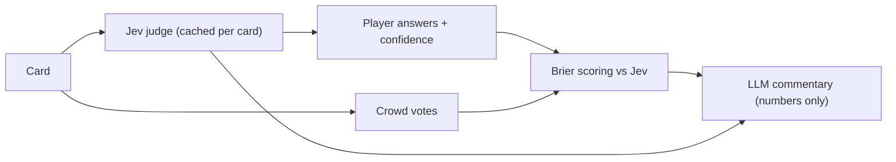

# Jev Decision Game — "Should the agent do this?"

A fast, playful quiz about AI-agent judgment. Each card shows an AI agent about to take an
action ("A support agent wants to refund $480. The customer says the package never arrived,
but tracking shows it was delivered."). You pick **Allow / Ask a human / Block**, set a
confidence slider, and the reveal compares your call with **Jev's probabilities** (Jev is
TypeSafe AI's fast decision model) and the **crowd's** vote split.

**Jev judges, code scores, the crowd votes, and the LLM only writes cards and commentary.**

## How it works



1. A card is dealt. If it hasn't been judged yet, one request goes to Jev with every
   question batched (verdict, harm, reversible, in-scope, info-enough, and the
   option-order check). The judgment is **cached on the card row**, so Jev is called once
   per card, not once per player.
2. The player picks an option and sets confidence (50–100%).
3. Scoring is pure TypeScript: the player's distribution (`c` on their pick,
   `(1-c)/2` on the others) is scored with a **Brier score** against Jev's verdict
   probabilities (uncertain excluded, renormalized). Points = `round(100 × (1 − Brier))`,
   plus +20 for a **Contrarian hit** (agreeing with Jev while the crowd majority
   disagreed). Streaks count consecutive agreements with Jev.
4. The crowd split is shown only after you answer; below 5 votes it's labeled "Early crowd".
5. The LLM writes two sentences of commentary, constrained to cite only the numbers it
   was given — it never explains Jev's reasoning.

## Why calibrated probabilities make a better game than a single right answer

A single right answer punishes you for disagreeing with the key even when you were
basically right. Calibration scoring rewards the *shape* of your judgment: if you say 70%
and you're right about 70% of the time, you score well over time even when individual
calls go against you. It also lets the game show a real probability distribution instead
of a binary verdict, which is closer to how judgment actually works — many of these calls
genuinely sit between "allow" and "ask a human."

## Game modes

- **Daily deck** — the same 10 cards for everyone each day (picked at random by the
  `daily-deck` edge function on the first request of the UTC day), with a
  shareable emoji-square result grid.
- **Endless** — random cards, filterable by theme.
- **Agree with the crowd?** — predict the crowd's majority instead of Jev's verdict.
- **Make a card** — propose your own scenario. A safety gate (two Jev nouls:
  `is_agent_action ≥ 0.7`, `unsafe_content < 0.2`) must pass before the card is judged
  and published.

## Stack

Vite + React + TypeScript + Tailwind, Supabase (Postgres + Edge Functions), lucide-react,
recharts, framer-motion. No auth: players pick a nickname stored in localStorage with a
random `player_id`.
The browser only reads tables with the anon key; cards, votes and daily decks are
written by edge functions running with the service role (`submit-card`, `card-writer`,
`submit-vote`, `daily-deck`).

## Setup

```bash
supabase secrets set TYPESAFE_API_KEY=... OPENAI_API_KEY=...
supabase functions deploy jev-judge card-writer submit-card submit-vote daily-deck
npm install
npm run dev
```

## Environment variables / secrets

| Secret (edge functions, server-side only) | Used by | Purpose |
| --- | --- | --- |
| `TYPESAFE_API_KEY` | `jev-judge`, `submit-card` | Calls the TypeSafe SystemOne API (model `jev-1.13.0`, pinned) |
| `OPENAI_API_KEY` | `card-writer` | Card generation and commentary. Without it, the bundled mock deck is used; Jev still runs live |
| `OPENAI_BASE_URL` (optional) | `card-writer` | Defaults to `https://api.openai.com/v1` |
| `OPENAI_MODEL` (optional) | `card-writer` | Defaults to `gpt-6-luna` (no `temperature` parameter is sent) |
| `DAILY_CALL_LIMIT` (optional) | `jev-judge`, `card-writer`, `submit-card` | Upstream requests allowed per function per UTC day (default `200`). Every Jev/LLM request, retries included, is counted first; over the cap the function returns `429 {"error":"daily_limit"}` |
| `VOTE_DAILY_LIMIT` (optional) | `submit-vote` | Votes allowed per `player_id` per UTC day (default `300`); over the cap the function returns `429` |
| `ADMIN_TOKEN` (optional, 16+ chars) | `jev-judge` | Required as the `x-admin-token` header for `force: true` (re-judge a cached card). Unset means force is disabled |

Client env (pre-populated by the platform): `VITE_SUPABASE_URL`, `VITE_SUPABASE_ANON_KEY`.

## Screenshot placeholders

- 
- 
- 
- 

## Design decisions

- **One Jev call per card, cached.** Every question for a card travels in a single
  request (Jev answers many questions per request, which is faster and cheaper than
  separate calls), and the result is stored on the card row. Players replaying a card
  never re-trigger Jev.
- **All scoring in code.** Jev returns raw probabilities; the Brier math, points,
  renormalization, streaks, and bonuses are pure TypeScript, unit-test friendly, and
  never delegated to a model.
- **Option-order check.** On first judgment, the same verdict question is sent again with
  the criteria in reverse order. If the top choice differs, the card is marked
  `order_sensitive` and gets a small "Jev wasn't sure" badge on reveal.
- **The LLM never explains Jev's reasoning.** The writer's commentary prompt may cite
  only the numbers it is handed (Jev's probabilities, harm, crowd split); it cannot
  speculate about why Jev chose what it chose. Cost is computed as
  `input_tokens × $0.042 / 1M` (output tokens free); a Jev 429/529 or network error is
  retried once with backoff, and the retry counts against the daily cap too.
